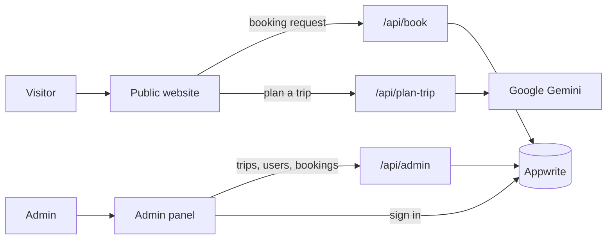

<h1 align="center">🌍 TravelSphere</h1>

<p align="center">
  <strong>Plan smarter. Travel further.</strong><br/>
  A travel website for India with an AI trip planner, online booking requests<br/>
  and a full admin panel with live analytics.
</p>

<p align="center">
  <a href="#-features">✨ Features</a> ·
  <a href="#-tech-stack">🛠️ Tech stack</a> ·
  <a href="#-how-it-works">🧩 How it works</a> ·
  <a href="#-getting-started">🚀 Getting started</a> ·
  <a href="#-appwrite-setup">🗄️ Appwrite setup</a> ·
  <a href="#-docker">🐳 Docker</a>
</p>

---

## 📖 About

TravelSphere has two sides in one codebase:

| | 🌐 Public website | 🛡️ Admin panel |
| --- | --- | --- |
| **Who uses it** | Any visitor, no account needed | Admins who sign in with Google |
| **Data** | Sample trips, ready to use | Real data stored in Appwrite |
| **What you can do** | Browse trips, plan with AI, send a booking request | Manage trips, bookings and users, read analytics |

---

## ✨ Features

### 🌐 Public website

| | Feature | Details |
| --- | --- | --- |
| 🏠 | **Landing page** | Hero, featured destinations across India, travel deals, reasons to choose us, FAQ and a footer with contact details |
| 🧭 | **Explore trips** | Search by place or interest, filter by group type, page through results at `/travel` |
| 🗓️ | **Trip pages** | Day-by-day itinerary, weather, best time to visit, price estimate and a map of the destination |
| 🎫 | **Booking requests** | Name, phone, date and travellers. Saved as *Pending* until an admin confirms. No payment step |
| 🤖 | **AI Trip Planner** | Pick a state, style, interests, budget, group and length at `/plan`. Uses Google Gemini, or a built-in planner without a key. Plans are not saved |

### 🛡️ Admin panel

| | Feature | Details |
| --- | --- | --- |
| 📊 | **Dashboard** | Key numbers plus charts for bookings, new trips, budget mix, group types, interests and popular states |
| 📈 | **Analytics** | Date-range selector and charts for bookings over time, status, travellers by month, group sizes, most booked trips and estimated profit by trip, style and state |
| 🧳 | **Trips** | Search, create with AI, edit every detail (itinerary, season, price, interests, cover image) or delete |
| 📞 | **Bookings** | Confirm, cancel or delete requests, and add bookings you take by phone |
| 👥 | **Users** | Make or remove admins, delete accounts, and a short guide for adding a new admin |
| 👤 | **Account** | Your profile and sign-out |

### 🔧 Built in

- 📱 Responsive layout for phones, tablets and desktops
- ⏳ Loading indicator between pages
- 🎨 Consistent charts, cards and tables built with Syncfusion components
- 🚦 Rate limiting and a hidden spam trap on the public booking and planner forms

---

## 🛠️ Tech stack

| | Area | Technology |
| --- | --- | --- |
| ⚛️ | Framework | React Router 8 (framework mode, server-side rendering) |
| 🟦 | Language | TypeScript and React 19 |
| 🧩 | UI components | Syncfusion: Grid, Charts, Maps, Pager, DropDowns, Buttons, Navigations |
| 🎨 | Styling | Tailwind CSS 4 |
| 🔣 | Icons | Lucide |
| 🗄️ | Backend and auth | Appwrite: database and Google sign-in |
| ✨ | AI | Google Gemini (optional) |
| 🐳 | Deployment | Docker, `Dockerfile` included |

---

## 🧩 How it works



> [!IMPORTANT]
> Every sensitive action (listing bookings, deleting a user, changing a role) runs on the server through `/api/admin`. That route checks the caller's session, confirms they are an admin and only then uses the server API key. **The key never reaches the browser.**

<details>
<summary><b>📍 All routes</b></summary>

<br/>

| Route | Purpose |
| --- | --- |
| `/` | Landing page |
| `/travel`, `/travel/:tripId` | Trip list and trip details with booking form |
| `/plan` | AI Trip Planner |
| `/sign-in` | Admin sign-in with Google |
| `/dashboard`, `/analytics` | Admin overview and analytics |
| `/trips`, `/trips/create`, `/trips/:tripId`, `/trips/:tripId/edit` | Admin trip management |
| `/bookings`, `/all-users`, `/account` | Admin bookings, users and profile |
| `/api/book`, `/api/plan-trip` | Public server routes (rate limited) |
| `/api/create-trip`, `/api/admin` | Admin-only server routes |

</details>

---

## 🚀 Getting started

### ✅ Prerequisites

- 🟢 Node.js **22.22 or newer** (the Docker image uses Node 24)
- 📦 npm
- 🗄️ An [Appwrite](https://appwrite.io/) project, Cloud or self-hosted
- 🔑 A Syncfusion license key (the community license is free)
- ✨ Optional: a Gemini API key from [Google AI Studio](https://aistudio.google.com/apikey)

### ⚡ Install and run

```bash
# 1. Clone the repository
git clone https://github.com/jasmeeeetsingh17/TravelSphere.git
cd TravelSphere

# 2. Install dependencies
npm install

# 3. Create your environment file and fill in the values
cp .env.example .env.local

# 4. Start the development server
npm run dev
```

Open **http://localhost:5173**. The public website works right away. The admin panel needs the Appwrite setup below.

---

## 🗄️ Appwrite setup

| Step | What to do |
| --- | --- |
| **1️⃣ Project** | Create a project and a database. Copy both IDs into `.env.local` |
| **2️⃣ Platform** | Add a **Web platform** for `localhost` (and your real domain when you deploy) |
| **3️⃣ Sign-in** | Enable **Google** under Auth, Settings, OAuth2 providers |
| **4️⃣ Users collection** | Create it with the attributes below |
| **5️⃣ Trips collection** | Create it with the attributes below |
| **6️⃣ Permissions** | Give role **Users** the Create and Read permissions on both collections |
| **7️⃣ API key** | Create a server key with the scopes listed below |
| **8️⃣ Bookings** | Open **Bookings** in the admin panel and press **Set up bookings** |

<details>
<summary><b>👥 Users collection attributes</b></summary>

<br/>

| Attribute | Type |
| --- | --- |
| `accountId`, `name`, `email`, `imageUrl`, `joinedAt` | string |
| `status` | string (`user` or `admin`) |

</details>

<details>
<summary><b>🧳 Trips collection attributes</b></summary>

<br/>

| Attribute | Type | Notes |
| --- | --- | --- |
| `tripDetail` | string, size 20000 | The whole trip stored as JSON |
| `imageUrls` | string array | Image paths |
| `userId` | string | Account ID of the creator |
| `createdAt` | string | ISO date |

</details>

<details>
<summary><b>🔑 API key scopes</b></summary>

<br/>

Create the key under **Overview, Integrations, API keys** with:

- `databases.read`
- `documents.read`
- `documents.write`
- `users.write`

To let the app create the bookings collection for you, also add `collections.write` and `attributes.write`.

</details>

<details>
<summary><b>📞 Creating the bookings collection by hand</b></summary>

<br/>

**Set up bookings** creates a private collection that only the server can read. To do it yourself, create a collection with the ID `bookings` and add the fields listed in `app/lib/booking-schema.ts`.

</details>

### 👑 Becoming the first admin

> [!NOTE]
> The first admin has to be set by hand.

1. Sign in once with Google at `/sign-in`. You will be told you are not an admin.
2. Open the users collection in the Appwrite console.
3. Set `status` to `admin` on your document.

From then on, admins can give or remove access for other people on the **Users** page.

---

## 🔐 Environment variables

Copy `.env.example` to `.env.local`.

> [!WARNING]
> Never commit `.env.local`. It is listed in `.gitignore`. Variables that start with `VITE_` are included in the browser bundle, so they must never hold secrets.

| Variable | Required | Description |
| --- | :---: | --- |
| `VITE_SYNCFUSION_LICENSE_KEY` | ✅ | Syncfusion license key |
| `VITE_APPWRITE_API_ENDPOINT` | ✅ | Appwrite endpoint, for example `https://cloud.appwrite.io/v1` |
| `VITE_APPWRITE_PROJECT_ID` | ✅ | Appwrite project ID |
| `VITE_APPWRITE_DATABASE_ID` | ✅ | Database that holds the collections |
| `VITE_APPWRITE_USERS_COLLECTION_ID` | ✅ | Users collection ID |
| `VITE_APPWRITE_TRIPS_COLLECTION_ID` | ✅ | Trips collection ID |
| `VITE_APPWRITE_BOOKINGS_COLLECTION_ID` | ➖ | Bookings collection ID. Defaults to `bookings` |
| `APPWRITE_API_KEY` | ✅ | 🔒 **Server only.** Used by the admin and booking routes |
| `GEMINI_API_KEY` | ➖ | 🔒 **Server only.** Enables real AI itineraries. Without it, trips come from a template |
| `GEMINI_MODEL` | ➖ | Gemini model name. Defaults to `gemini-2.5-flash` |

---

## 🌱 Sample data

Fill the admin panel with something to look at:

```bash
npm run seed              # adds 18 Indian trips and about 64 bookings
npm run seed -- --remove  # deletes the sample data again
```

> [!TIP]
> The script is safe to run twice. Trips with the same name and bookings that already exist are skipped. Sample bookings use phone numbers that start with `90000` and `@example.com` emails, so they are easy to recognise. It needs `APPWRITE_API_KEY` and the Appwrite IDs in `.env.local`.

---

## 📜 Scripts

| Command | What it does |
| --- | --- |
| `npm run dev` | ▶️ Start the development server |
| `npm run build` | 📦 Create a production build |
| `npm start` | 🚢 Serve the production build |
| `npm run typecheck` | 🔍 Generate route types and run the TypeScript compiler |
| `npm run seed` | 🌱 Add or remove sample data in Appwrite |

---

## 🐳 Docker

```bash
docker build -t travelsphere .
docker run -p 3000:3000 \
  -e APPWRITE_API_KEY=your_key \
  -e GEMINI_API_KEY=your_key \
  travelsphere
```

Then open **http://localhost:3000**.

> [!NOTE]
> The `VITE_` values are read from `.env.local` while the image is built, so create that file before running `docker build`. The two server secrets are passed when the container starts and are not stored in the image.

---

## 📂 Project structure

```
TravelSphere/
├── app/
│   ├── appwrite/        Browser-side Appwrite calls (auth, trips, users, admin requests)
│   ├── constants/       Dropdown options, Indian states, map data, sample trips
│   ├── lib/             Shared helpers, trip generator, profit estimates, stats,
│   │                    chart theme, and server-only code (*.server.ts)
│   ├── routes/
│   │   ├── root/        Public website and sign-in
│   │   ├── admin/       Admin panel pages
│   │   └── api/         Server routes (booking, planner, admin actions)
│   ├── root.tsx
│   └── routes.ts        Route configuration
├── components/          Reusable UI such as TripCard, TripDetail, BookTrip,
│                        ChartCard, KpiCard, Modal and Spinner
├── public/assets/       Icons and images
├── scripts/             Sample data script
├── Dockerfile
└── .env.example
```

---

## 🎛️ Customising

| | What | Where |
| --- | --- | --- |
| ☎️ | Contact details on the landing page and footer (placeholders) | `CONTACT` in `components/LandingSections.tsx` |
| 💰 | Profit margins for each budget level | `app/lib/profit.ts` |
| 🗺️ | Sample trips for the public site | `app/constants/dummyTrips.ts` |
| 🎚️ | Travel styles, interests and budgets | `app/constants/index.ts` |

> [!NOTE]
> Trips do not store their real costs, so profit is an estimate based on the margins above. Change them and every analytics chart follows.

---

## 🔒 Security notes

- 🔑 Only the server holds the Appwrite API key. Admin actions check the caller's session and role first.
- 🙈 Booking details sit in a collection with no browser permissions, so names and phone numbers can only be read through the server.
- 🚦 The booking and planner forms are limited per visitor and include a hidden field that bots tend to fill in. The limiter keeps its counts in memory, which is fine for one server and resets on restart. Use a shared store if you run several instances.
- 🚪 Anyone who signs in with a non-admin Google account is signed out and shown a message.

---

## 🤝 Contributing

Contributions, issues and feature requests are welcome.

1. 🍴 Fork the repository
2. 🌿 Create a branch: `git checkout -b feature/your-feature`
3. 💾 Commit your changes: `git commit -m "Describe your change"`
4. 📤 Push the branch: `git push origin feature/your-feature`
5. 🔀 Open a pull request

Please run `npm run typecheck` before you open a pull request.

---

## 📄 License

Released under the MIT License.

## 👤 Author

**Jasmeet Singh** · [@jasmeeeetsingh17](https://github.com/jasmeeeetsingh17)

## 🙏 Acknowledgements

Built with [React Router](https://reactrouter.com/), [Appwrite](https://appwrite.io/), [Syncfusion](https://www.syncfusion.com/), [Tailwind CSS](https://tailwindcss.com/), [Lucide](https://lucide.dev/) and [Google Gemini](https://ai.google.dev/).

---

<p align="center">⭐ If you like this project, give it a star!</p>
